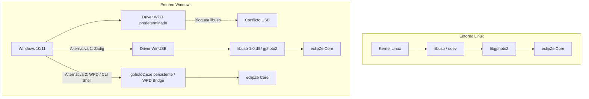
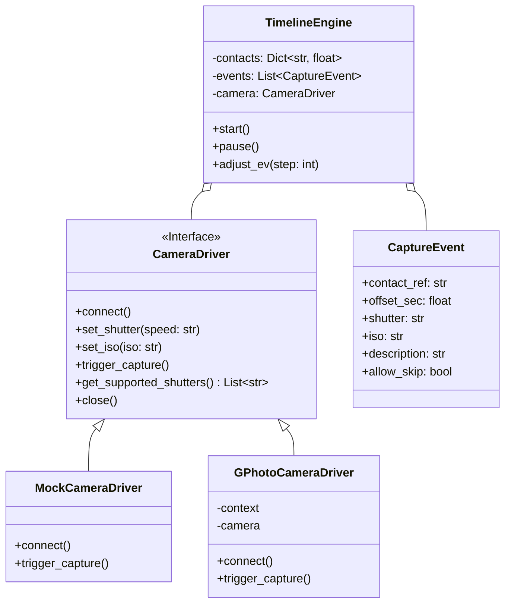

# Análisis de Viabilidad Técnica y Arquitectura: eclipZe

**Proyecto:** eclipZe — Gestor y secuenciador automatizado de capturas para eclipses solares y lunares  
**Cámaras objetivo prioritarias:** Nikon Z5 II (mirrorless FX) y Nikon D750 (DSLR FX)  
**Sistemas Operativos:** Windows 10/11 y Linux (Debian/Ubuntu/Fedora/Arch)  
**Fecha de análisis:** Noviembre 2026  

---

## 1. Veredicto Ejecutivo de Viabilidad

> [!NOTE]
> **Veredicto:** **100% Viable técnicamente**. El proyecto puede implementarse de forma robusta con una arquitectura modular en Python, aprovechando librerías ya instaladas en el entorno (`astropy`, `PySide6`, `numpy`). Existen dos puntos críticos que requieren decisiones de diseño claras: la gestión del driver USB en Windows y la diferencia de cadencia mecánica entre la Nikon Z5 II y la Nikon D750.

---

## 2. Análisis de Hardware: Nikon Z5 II vs Nikon D750

Ambas cámaras se comunican mediante el protocolo estándar **PTP (Picture Transfer Protocol / ISO 15740)** con la extensión propietaria de Nikon (Vendor ID `0x04b0`). Sin embargo, su comportamiento dinámico es radicalmente distinto:

| Característica | Nikon Z5 II | Nikon D750 | Impacto en eclipZe |
| :--- | :--- | :--- | :--- |
| **Tecnología** | Mirrorless (Sin espejo) | Réflex (DSLR con espejo mecánico) | En D750 el espejo debe levantarse y bajarse salvo en Live View. |
| **Procesador** | EXPEED 7 | EXPEED 4 | Z5 II procesa comandos PTP y vacía el búfer ~3x más rápido. |
| **Interfaz USB** | USB-C (USB 3.2 Gen 1) | UC-E6 (USB 2.0 High Speed, ~30 MB/s) | En D750 la descarga de RAW colapsaría el bus; la Z5 II admite ráfagas sostenidas. |
| **Obturador** | Electrónico silencioso hasta 1/8000s+ | Mecánico cortinilla (Mirror slap) | En D750 hay trepidación por espejo; requiere Live View obligatorio en totalidad. |
| **Dial de Modo** | Configurable / Virtual | Dial mecánico físico | En D750 el dial debe estar físicamente en **M (Manual)**; si no, PTP falla al cambiar velocidad. |
| **Alimentación** | Admite USB-PD directo | Requiere acoplador ficticio (Dummy battery) | Z5 II puede alimentarse del mismo PC o powerbank USB-C sin agotar batería. |
| **Latencia PTP comando** | $\approx 40 - 70\text{ ms}$ | $\approx 150 - 220\text{ ms}$ | El secuenciador debe usar perfiles de seguridad distintos (`safety_margin`). |

### Reglas críticas de disparo en cámara:
1. **Destino de almacenamiento forzado (`capturetarget = Memory card`):**
   * Durante la totalidad de un eclipse solar no se deben descargar los archivos RAW/NEF por USB. La cámara debe almacenar directamente en sus tarjetas SD/CFexpress internas. El PC únicamente envía comandos de ajuste (`shutterspeed`, `iso`) y pulso de disparo asíncrono (`trigger_capture`).
2. **Desactivación de Long Exposure Noise Reduction (NR):**
   * Si está activo, la cámara realiza una segunda toma con obturador cerrado de igual duración (*dark frame*), duplicando el tiempo de ciclo y perdiendo el 50% de la ventana del eclipse.
3. **Enfoque y Balance de Blancos Manual:**
   * Autofoco apagado en lente/cuerpo (foco manual fijo a infinito calibrado previamente). Balance de blancos fijo (luz día ~5500K) para evitar que el firmware gaste tiempo recalculando.

---

## 3. Estrategia Multiplataforma: El Reto de Windows vs Linux

En **Linux**, la comunicación USB con cámaras es limpia y directa mediante `libgphoto2` y `libusb`.
En **Windows**, el sistema operativo asigna automáticamente el controlador **WPD (Windows Portable Devices)**, que monopoliza la cámara e impide el acceso libre a los endpoints USB a nivel de driver estándar.



### Opciones de Conexión en Windows evaluadas:

1. **Opción A: Sustitución de Driver con Zadig a WinUSB (Recomendada para máxima velocidad):**
   * Se usa la herramienta estándar Zadig para asociar el endpoint de la Nikon a `WinUSB`.
   * *Ventaja:* Acceso directo de bajísima latencia ($<50\text{ ms}$), idéntico a Linux.
   * *Inconveniente:* Requiere que el usuario ejecute Zadig una única vez por puerto USB.
2. **Opción B: Binario `gphoto2.exe` en modo `--shell` interactivo:**
   * Se empaqueta una compilación ligera de MinGW/MSYS2 de `gphoto2.exe`. En lugar de invocar un proceso nuevo por cada disparo (lo que añade 150 ms de retardo), eclipZe abre un subproceso con `gphoto2 --shell` y canaliza comandos por `stdin` manteniendo la sesión USB abierta.
   * *Ventaja:* No requiere compilar módulos C en Python para Windows.
3. **Opción C: Motor de Simulación (Mock):**
   * Imprescindible para desarrollo y pruebas sin tener la cámara física conectada. Permite simular los tiempos de respuesta reales de una Z5 II o D750 y verificar el secuenciador al 100%.

---

## 4. Comparativa Funcional: Eclipse Solar vs Eclipse Lunar

El usuario solicita soporte para ambos fenómenos. Sus dinámicas fotográficas son opuestas:

```
┌─────────────────────────────────┬──────────────────────────────────┐
│         ECLIPSE SOLAR           │          ECLIPSE LUNAR           │
├─────────────────────────────────┼──────────────────────────────────┤
│ Ventana crítica: 1 a 4 minutos  │ Ventana amplia: 1 a 3 horas      │
│ Rango dinámico: 14+ stops       │ Rango dinámico: 10-12 stops      │
│ Modo: Timeline relativo C1-C4   │ Modo: Intervalómetro + Bracket   │
│ Ráfagas ultra-rápidas en C2/C3  │ Cadencia regular (cada 15s - 1m) │
│ Avisos de filtro solar vitales  │ Sin filtros solares              │
│ Política Drop-and-Skip estricta │ Prioridad a calidad y exposición │
└─────────────────────────────────┴──────────────────────────────────┘
```

### A. Para Eclipse Solar:
* **Fases críticas:** Contactos $C_1, C_2, \text{MAX}, C_3, C_4$.
* **Automatización de horquillado (Bracketing):**
  * Justo antes de $C_2$: Disparos ultrarrápidos para Perlas de Baily y Anillo de Diamante ($1/4000\text{s}$ a $1/1000\text{s}$).
  * Totalidad ($C_2 \to C_3$): Horquillados completos en ráfaga para capturar cromosfera ($1/1000\text{s}$), corona interna ($1/250\text{s}$), corona media ($1/30\text{s}$) y corona externa débil con brillo de la Tierra ($1\text{s}$ a $4\text{s}$).
* **Avisos de voz sonoros:** Cuentas atrás de $C_2$ y avisos para retirar el filtro solar ("¡Retirar filtro!") y recolocarlo antes de $C_3$ ("¡Poner filtro!").

### B. Para Eclipse Lunar:
* **Fases críticas:** Contactos penumbrales ($P_1, P_4$) y umbrales ($U_1, U_2, \text{MAX}, U_3, U_4$).
* **Comportamiento:** La totalidad umbral dura más de una hora. El desafío no es la velocidad en milisegundos, sino el *exposure ramping* (la transición suave de brillo entre la Luna llena brillante y la Luna roja oscura) y la estabilidad térmica/batería durante varias horas de sesión.
* **Modo de disparo:** Intervalómetro inteligente con horquillado de 3 a 5 tomas cada intervalo de tiempo programable (ej. cada 30 segundos).

---

## 5. Arquitectura Propuesta para eclipZe

Siguiendo el principio de **código mínimo necesario** (Lazy Senior Developer / Ponytail):



### Componentes clave:
1. **`CameraDriver` (Interfaz desacoplada):**
   * Permite cambiar entre la cámara real y un `MockCameraDriver` sin alterar una sola línea del motor del eclipse.
2. **`TimelineEngine`:**
   * Despachador de tiempo de alta resolución (`time.perf_counter` o `time.time`).
   * Mecanismo *Drop-and-skip*: Si un disparo se retrasa más de 350 ms respecto a su ventana teórica y tiene `allow_skip=True`, se descarta inmediatamente para no encadenar retrasos en la totalidad.
3. **`LiveExposureOffset`:**
   * Atajos de teclado en la interfaz para compensar la exposición global en $\pm 1$ o $\pm 2$ EV (por ejemplo, si aparecen nubes altas inesperadas).
4. **`AudioNotifier`:**
   * Síntesis de voz ligera con `pyttsx3` ejecutada en un hilo en segundo plano (no bloqueante).
5. **Interfaz Gráfica (PySide6):**
   * Vista de línea de tiempo con progreso en tiempo real, cuenta atrás hasta el siguiente contacto, botón de parada de emergencia y visualizador de estado de disparo.

---

## 6. Riesgos Identificados y Mitigaciones

| Riesgo | Impacto | Mitigación |
| :--- | :--- | :--- |
| **Colapso del búfer de la cámara** | Pérdida de disparos en totalidad | Guardar solo en tarjeta SD/CFexpress rápida (V90 o UHS-II / CFexpress Type B). Mantener margen de seguridad entre ráfagas. |
| **Desconexión USB accidental** | Fin de la captura | Cables USB-C con tornillo de fijación mecánica al *cage* de la cámara; reconexión automática en caliente en eclipZe. |
| **Desfase de reloj del ordenador** | Disparar a destiempo de C2/C3 | Sincronización previa por NTP antes de salir a campo o lectura de dongle GPS USB (NMEA por puerto serie). |
| **Batería agotada** | Apagado en medio del evento | Alimentación continua vía USB-PD (Z5 II) o batería acopladora ficticia (D750). |
| **Bloqueo del driver en Windows** | La app no detecta la cámara | Procedimiento documentado con Zadig para asociar WinUSB o backend compatible con WPD. |

---

## 7. Plan de Acción y Próximos Pasos

1. **Fase 1 (Núcleo):** Implementar la interfaz `CameraDriver` con un `MockCameraDriver` completo y el motor de eventos determinista con *drop-and-skip*.
2. **Fase 2 (Conectividad USB):** Implementar el controlador real para Nikon (vía `libgphoto2` / `pyusb` / CLI wrapper) y validar el snapping de velocidades con la Z5 II y D750.
3. **Fase 3 (Astronomía y Guiones):** Integrar perfiles predefinidos de horquillado para Eclipse Solar (basado en contactos C1-C4) y Eclipse Lunar (intervalómetro bracket).
4. **Fase 4 (UI PySide6):** Crear la interfaz gráfica multiplataforma compacta y el sistema de alertas por voz.
