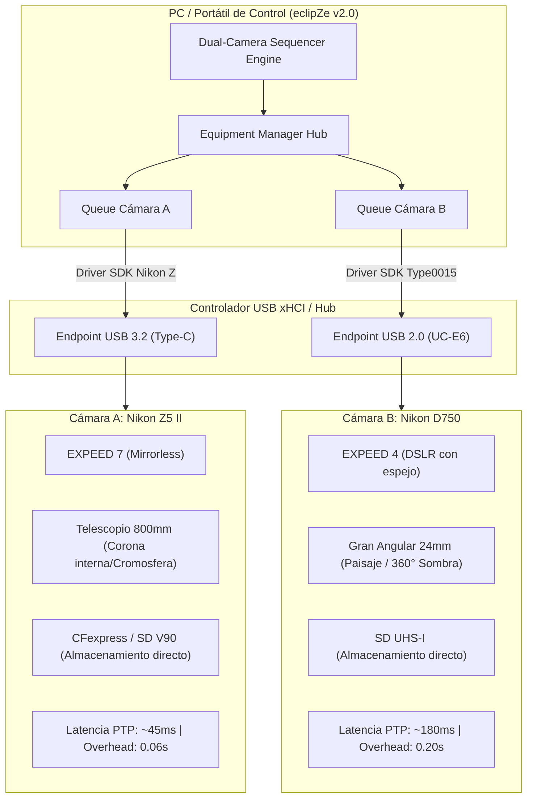
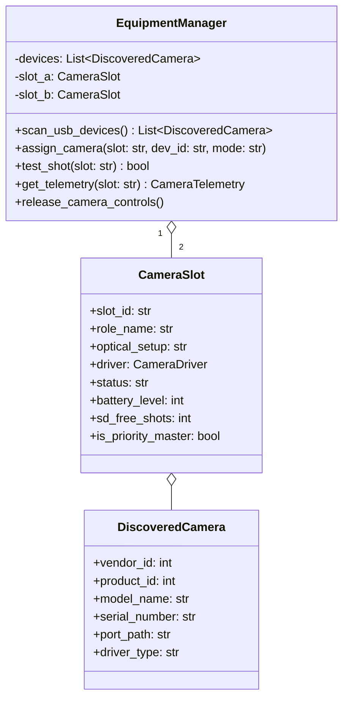
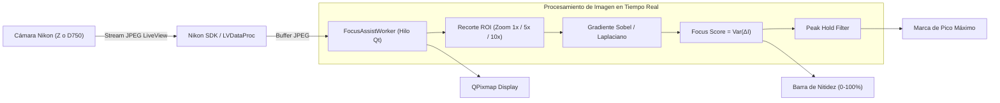
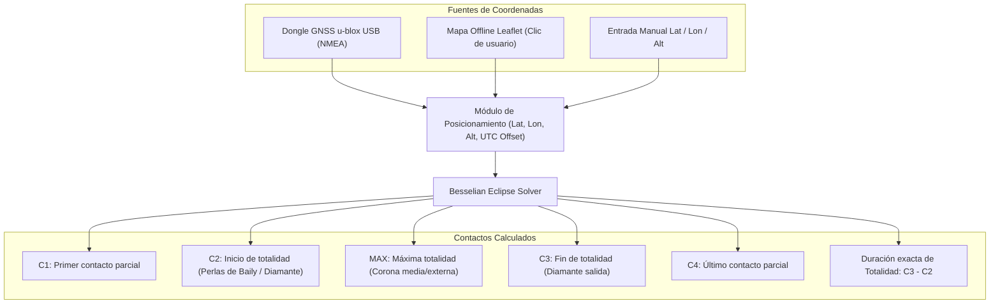
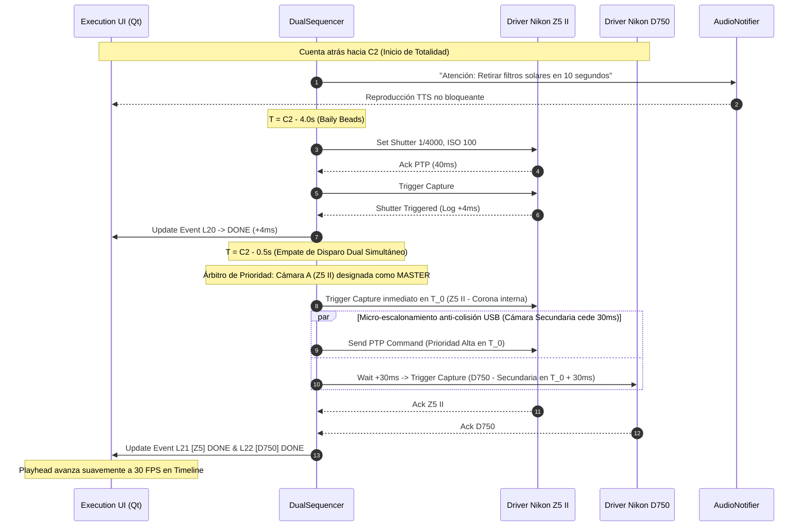

# Documento de Diseño e Implementación del Sistema: eclipZe v2.0
**Arquitectura de Control Multi-Cámara, Asistente de Enfoque, Motor Astronómico y Línea de Tiempo de Ejecución**

* **Proyecto:** eclipZe — Gestor y Secuenciador Automatizado para Eclipses Solares y Lunares
* **Cámaras Objetivo:** Nikon Z5 II (Mirrorless EXPEED 7) y Nikon D750 (DSLR EXPEED 4)
* **Referencia Funcional:** eclipseClick (https://eclipseclick.com/features/) y análisis de telemetría de ejecución en tiempo real
* **Entorno de Ejecución:** Windows 10/11 & Linux (Debian/Ubuntu/Fedora/Arch)
* **Fecha:** Noviembre 2026
* **Estado:** Aprobado para Implementación

---

## 1. Resumen Ejecutivo y Objetivos

El presente documento define la arquitectura técnica y el diseño de experiencia de usuario para la versión 2.0 de **eclipZe**. Tomando como referencia las capacidades de vanguardia del software **eclipseClick** y las lecciones aprendidas de la prueba de concepto (PoC) inicial de eclipZe, se formalizan las especificaciones para transformar la herramienta en una estación de control astronómico de grado profesional para fotografía de eclipses.

```
┌─────────────────────────────────────────────────────────────────────────────┐
│                             eclipZe v2.0 CORE                               │
├─────────────────────┬───────────────────────────┬───────────────────────────┤
│    MULTI-CAMERA     │   ASTRONOMY & POSITION    │    EXECUTION ENGINE       │
│ • Control Dual PnP  │ • GNSS USB u-blox         │ • Timeline interactivo    │
│ • Nikon Z + D750    │ • Mapa Offline Leaflet    │ • Jitter milimétrico      │
│ • Cero caída de bus │ • Solver C1-C4 + Altitud  │ • Banner NEXT dinámico    │
├─────────────────────┼───────────────────────────┼───────────────────────────┤
│  LIVE VIEW & FOCUS  │    ECLIPSE CALENDAR       │     MODERN DARK UI        │
│ • Stream JPEG PTP   │ • Base de datos 2026-2035 │ • Sidebar de navegación   │
│ • Zoom ROI 1x/5x/10x│ • Eclipses España 26/27   │ • Equipment Manager       │
│ • Focus Peak Score  │ • Carga automática 1-clic │ • Alto contraste campo    │
└─────────────────────┴───────────────────────────┴───────────────────────────┘
```

### Objetivos Clave de la Versión 2.0:
1. **Control Simultáneo Dual (Nikon Z5 II + Nikon D750):** Permitir conectar y disparar dos cámaras simultáneamente (ej. Z5 II con teleobjetivo/telescopio para cromosfera/corona y D750 con gran angular para paisaje y totalidad contextual) sin colisiones en el bus USB y respetando las cadencias mecánicas asimétricas de cada cuerpo.
2. **Reemplazo del Selector de Cámara PoC por un Gestor de Equipamiento:** Sustituir el menú desplegable estático por un panel dinámico de detección Plug & Play, estado de batería, ranuras SD y asignación de roles fotográficos (Cámara A Primaria / Cámara B Secundaria).
3. **Módulo de Live View y Asistente de Enfoque (Focus Assist):** Visualización en directo antes del eclipse para calibración de foco ultrapreciso sobre el limbo solar o manchas solares con filtro, incorporando zoom digital ROI y algoritmo de medición de nitidez (Laplacian Peak Hold).
4. **Motor de Posicionamiento y Efemérides Astronómicas:** Integración dual de adquisición de coordenadas (vía satélite con dongle GPS USB o selección interactiva en mapa offline) para resolver los contactos $C_1, C_2, \text{MAX}, C_3, C_4$ en función de la topografía exacta.
5. **Calendario de Eclipses 2026–2035:** Catálogo interactivo con los eclipses clave (España 2026, España/Egipto 2027, etc.) y cálculo local de visibilidad y contactos.
6. **Timeline Visual y Monitor de Ejecución en Tiempo Real (Inspirado en eclipseClick):** Interfaz de ejecución determinista con barra de fases coloreadas (DR, BB, CH, PR, Totality), cursor temporal en vivo, log de eventos con jitter en milisegundos (`+4ms`, `+53ms`) y banner `NEXT` con cuenta atrás milimétrica.

---

## 2. Análisis de Referencia: eclipseClick

**eclipseClick** se ha consolidado como un referente moderno en astrofotografía de eclipses al resolver las deficiencias de ergonomía y fiabilidad de programas históricos (Eclipse Orchestrator, Solar Eclipse Maestro).

### 2.1 Desglose de Características de eclipseClick

| Característica | Implementación eclipseClick | Enfoque eclipZe v2.0 |
| :--- | :--- | :--- |
| **Filosofía** | *"Invisible Software"*: Automatizar todo para no tocar el teclado durante la totalidad. | Idéntico. Secuencia 100% autónoma con avisos de voz de seguridad para filtros. |
| **Precisión de Contactos** | Elementos Besselianos NASA + corrección de limbo lunar con DEM LRO LOLA (~470m/px) en modo Geométrico o Baily's Beads. | Algoritmo Besseliano local + corrección de elevación topográfica + calibración GPS/NTP. |
| **Control Multi-Cámara** | Soporte para conectar múltiples cámaras y ejecutar secuencias coordinadas. | **Motor Dual Orquestado**: Nikon Z5 II (USB-C) + Nikon D750 (USB 2.0) con hilos desacoplados y desfase microtemporal anti-colisión. |
| **Live View y Enfoque** | Live View integrado para verificación previa de encuadre y foco. | **Focus Assist Avanzado**: Stream PTP, Zoom ROI (1x, 5x, 10x), retícula de alineación y Focus Score por varianza de gradiente. |
| **Monitor de Ejecución** | Timeline continuo de fases en color + Log con jitter temporal + Banner NEXT con cuenta atrás. | **Timeline UI Réplica Funcional**: Widget Qt interactivo con bloques DR, BB, CH, PR, Totality, playhead en vivo y log milimétrico. |
| **Recuperación de Fallos** | Reconexión automática de cables y protección contra bloqueos. | Watchdog USB en hilo secundario con auto-reconocimiento PnP y política *drop-and-skip*. |

### 2.2 Análisis de la Telemetría de Ejecución (Referencia Gráfica)

La interfaz de ejecución analizada en la captura de pantalla de eclipseClick (`media_1793802617663_b80f4aa6.png`) destaca por los siguientes componentes críticos que eclipZe v2.0 adopta y perfecciona:

```
┌─────────────────────────────────────────────────────────────────────────────────────────────────────────┐
│ [||] Pause   [X] Abort                                                                                  │
├─────────────────────────────────────────────────────────────────────────────────────────────────────────┤
│ Eclipse Timeline                                                                              Full view │
│ ┌───────────────────────────┬──────────────┬──────────────┬───────────────────────────────┐             │
│ │            DR             │      BB      │      CH      │              PR               │             │
│ └───────────────────────────┴──────────────┴───────│──────┴───────────────────────────────┘             │
│  ▼       ▼      ▼        ▼        ▼        ▼       │  ▼     ▼        ▼           ▼                        │
│  ● DR  ● BB  ● CH  ● PR  ● Totality  ● Scheduled  ▲ Playhead (Hora actual UTC)                          │
├─────────────────────────────────────────────────────────────────────────────────────────────────────────┤
│ Execution Log                                                                                           │
│ 39 events recorded | 17 captures succeeded                                                              │
│                                                                                                         │
│  ● L20 [NIKON-Z ] Chromosphere (C2) #1  1/8000 f/5.6 ISO 200  21:20:07.164 +21:20:07.168   +4ms   DONE   │
│  ● L21 [NIKON-Z ] Chromosphere (C2) #2  1/8000 f/5.6 ISO 200  21:20:08.114 +21:20:08.114   +0ms   DONE   │
│  ● L22 [NIKON-D7] Landscape Wide    #1  1/1000 f/8.0 ISO 100  21:20:09.000 +21:20:09.012  +12ms   DONE   │
│  ● L23 [NIKON-Z ] Chromosphere (C2) #4  1/8000 f/5.6 ISO 200  21:20:10.614 +21:20:10.614   +0ms   DONE   │
│  ● L24 [NIKON-Z ] Chromosphere (C2) #5  1/8000 f/5.6 ISO 200  21:20:11.864 +21:20:11.917  +53ms   DONE   │
├─────────────────────────────────────────────────────────────────────────────────────────────────────────┤
│ [▶ NEXT]  L25 T - 0:00.120   1/4000 f/5.6 ISO 200 — Prominences #1 [NIKON-Z]                            │
└─────────────────────────────────────────────────────────────────────────────────────────────────────────┘
```

* **Codificación Cromática de Fases Astronómicas:**
  * `DR` (Diamond Ring / Anillo de Diamante): Tono cian / teal oscuro (`#3B8288`).
  * `BB` (Baily's Beads / Perlas de Baily): Tono ocre / amarillo oro (`#C99A3E`).
  * `CH` (Chromosphere / Cromosfera y Protuberancias bajas): Tono teja / naranja rojizo (`#B85338`).
  * `PR` (Prominences & Corona / Totalidad): Tono púrpura / magenta tenue (`#8E527D`).
* **Marcadores de Disparos:** Triángulos y puntos verdes en la parte superior e inferior de la barra marcando los instantes exactos programados.
* **Playhead:** Línea vertical roja animada a 30 FPS que se desplaza exactamente a la velocidad del reloj real.
* **Log de Ejecución de Alta Precisión:**
  * Indicador de éxito (punto verde) o advertencia (punto amarillo/rojo).
  * ID del evento (`L20`, `L21`...).
  * Badge del dispositivo emisor (`[DSUSB]`, `[NIKON-Z]`, `[NIKON-D750]`).
  * Etiqueta de la fase física (`Chromosphere (C2) #1`).
  * Ajustes de exposición aplicados (`1/8000 f/5.6 ISO 200`).
  * Tiempos: Tiempo teórico programado vs. Tiempo real ejecutado.
  * **Jitter en milisegundos:** Indicador crucial de salud temporal (`+0ms`, `+4ms`, `+53ms`). Desfases superiores a 50 ms se colorean en amarillo/rojo alertando de latencia en la cámara o bus.
  * Estado de finalización: `DONE`, `SKIPPED`, `FAIL`.
* **Banner NEXT:** Barra horizontal destacada con cuenta atrás granular en milisegundos (`T - 0:00.120`) y parámetros inmediatos.

---

## 3. Arquitectura del Motor Dual de Cámaras (Nikon Z + Nikon D750)

### 3.1 El Desafío del Control Dual en Campo

El uso simultáneo de una **Nikon Z5 II** y una **Nikon D750** presenta un escenario heterogéneo:



### 3.2 Especificaciones Técnicas y Asimetría Operativa

| Parámetro Operativo | Nikon Z5 II (Cámara A) | Nikon D750 (Cámara B) | Estrategia eclipZe v2.0 |
| :--- | :--- | :--- | :--- |
| **Rol Típico** | Foco principal (Corona, Prominencias) | Contexto (Paisaje, Atmósfera, Sombra) | Guiones de disparo independientes o sincronizados. |
| **Obturador** | Electrónico silencioso (Cero vibración) | Mecánico con espejo réflex | En D750: Bloqueo de espejo o ráfaga controlada. |
| **Overhead Seguro** | $60\text{ ms}$ entre tomas | $200\text{ ms}$ entre tomas | El secuenciador aplica límites de cadencia por cámara. |
| **Lead Time PTP** | $\approx 45\text{ ms}$ anticipación | $\approx 180\text{ ms}$ anticipación | El despachador envía el pulso $T_0 - \text{LeadTime}$ para que el obturador coincida. |
| **Almacenamiento** | **Exclusivo en tarjeta interna** | **Exclusivo en tarjeta interna** | **Regla de oro:** Cero transferencias RAW por USB durante la totalidad. |
| **Driver Windows** | `Win_DRV/Nikon_Z/TestApp.exe` / PTP | `Win_DRV/Nikon_D750/Type0015Ctrl.exe` | Procesos aislados gestionados por hilos independientes. |

### 3.3 Prevención de Colisión en el Bus USB y Política de Prioridad por Empate Temporal (Priority Arbiter)

En una configuración de doble cuerpo, es común que ambas cámaras tengan disparos programados en el mismo milisegundo astronómico (por ejemplo, el instante exacto del segundo contacto $C_2$, donde se busca registrar simultáneamente el destello del Anillo de Diamante en alta resolución y el oscurecimiento súbito del paisaje en gran angular).

Para evitar contención en el controlador xHCI o colisión de paquetes en el concentrador USB, eclipZe v2.0 incorpora un **Árbitro de Prioridad (Priority Arbiter)**:

```
                  ┌──────────────────────────────────────────────┐
                  │ Evento programado: T_A ≈ T_B (|ΔT| < 25 ms) │
                  └──────────────────────┬───────────────────────┘
                                         ▼
                          ┌─────────────────────────────┐
                          │ ¿Qué cámara tiene prioridad │
                          │ asignada en Equipamiento?   │
                          └──────────────┬──────────────┘
                                         │
                 ┌───────────────────────┴───────────────────────┐
                 ▼                                               ▼
   [CÁMARA PRINCIPAL / MASTER]                     [CÁMARA SECUNDARIA / SLAVE]
• Ejecución instantánea en T_0                   • Micro-escalonamiento automático:
• Cero retardo inducido (+0 ms)                    T_ejecución = T_0 + 30 ms
• Inmunidad Drop-and-Skip en fases críticas      • Cede el bus USB de forma segura
• Máxima prioridad de CPU en hilo PTP            • Política Drop-and-Skip permisiva
```

#### Reglas de Arbitraje de Empate:
1. **Designación de Cámara Principal (Master):** En la configuración de equipamiento, el usuario selecciona explícitamente cuál de las dos cámaras tiene el rol de **Prioridad Máxima** (ej. Nikon Z5 II en telescopio).
2. **Resolución de Empate en Milisegundos:** Cuando $|T_A - T_B| < 25\text{ ms}$:
   * La **Cámara Principal** dispara con prioridad absoluta en su instante exacto ($T_0$), sin demoras ni modificaciones de cadencia.
   * La **Cámara Secundaria** sufre un desplazamiento temporal determinista de $+30\text{ ms}$ (micro-escalonamiento), evitando la colisión de paquetes Bulk en el bus USB y garantizando un jitter $< 5\text{ ms}$ en la cámara principal.
3. **Jerarquía en Situaciones de Retardo o Latencia de Bus:** Si por condiciones extremas la cola de eventos acumula un retraso superior al umbral de seguridad ($> 250\text{ ms}$):
   * La cámara principal preservará siempre sus eventos críticos (`allow_skip=False` prioritario).
   * La cámara secundaria activará el descarte selectivo (*drop-and-skip*) para no retener el bus ni comprometer la siguiente toma de la cámara principal.

---

## 4. Rediseño del Selector de Cámara: Panel de Gestión de Equipamiento

### 4.1 Problema del Selector PoC Actual
El selector actual consiste en un `QComboBox` estático con textos como `"Nikon Z5 II (SDK Oficial Plug&Play)"` y `"Nikon D750..."`. Presenta severas limitaciones:
* No permite seleccionar y utilizar dos cámaras reales conectadas a la vez.
* No detecta qué dispositivos físicos están realmente enchufados en el bus USB.
* Si una cámara se desconecta, la interfaz no reacciona hasta que un disparo falla.
* Mezcla opciones de hardware real con simuladores (Mock).

### 4.2 Arquitectura del `EquipmentManager`

Se sustituye el combo box por una vista dedicada de **Gestión de Equipamiento**:



### 4.3 Componentes de la Interfaz de Equipamiento

1. **Botón "Escanear Dispositivos USB":** Invoca la enumeración física de endpoints USB (`0x04B0` Nikon) y del SDK oficial.
2. **Selector Global de Prioridad de Disparo:**
   * Selector conmutador: *"⭐ Cámara Principal (Prioridad en empate temporal): [Ranura A | Ranura B]"*.
   * Garantiza que el usuario decida visualmente cuál de los dos cuerpos es el amo (*Master*) y tendrá precedencia absoluta en $T_0$.
3. **Tarjeta de Ranura A (Cámara A):**
   * Selector desplegable poblado automáticamente con cámaras detectadas (ej. `Nikon Z5 II [SN: 2004812] - USB 3.2`).
   * Campo de configuración óptica: Ej. *"Telescopio ED80 600mm f/7.5"*.
   * Indicador Badge de Prioridad: `[⭐ MASTER / PRINCIPAL]` o `[SLAVE / SECUNDARIA]`.
   * Indicadores de telemetría: Nivel de batería (%), estado de tarjeta SD (estimación de disparos libres).
   * Botón *"⚡ Disparo de Prueba A"*.
   * Botón *"👁️ Abrir Live View"*.
4. **Tarjeta de Ranura B (Cámara B):**
   * Selector desplegable poblado con dispositivos restantes o modo *"Simulación (Mock)"*.
   * Campo de configuración óptica: Ej. *"Nikkor 24-70mm @ 24mm f/5.6"*.
   * Indicador Badge de Prioridad: `[⭐ MASTER / PRINCIPAL]` o `[SLAVE / SECUNDARIA]`.
   * Botón *"⚡ Disparo de Prueba B"*.
5. **Modo Seguro de Desconexión / Liberación:**
   * Botón *"🔓 Liberar Cámaras"*: Cierra temporalmente la sesión PTP para que el usuario pueda reproducir fotos en la pantalla LCD de la cámara o ajustar menús manuales sin tener que desconectar el cable.

---

## 5. Módulo de Live View y Asistente de Enfoque (Focus Assist)

### 5.1 Caso de Uso y Necesidad en Campo
En astrofotografía solar, enfocar a través de un filtro ND 5.0 (filtro solar blanco o Baader Solar Safety Film) es una de las tareas más críticas. Durante el eclipse parcial previo a la totalidad, el disco solar sólo presenta bordes afilados (limbo solar) y posibles manchas solares. Si el foco manual tiene una desviación micrométrica, los detalles finos de la cromosfera y las protuberancias de la totalidad saldrán desenfocados.

### 5.2 Arquitectura del Módulo `FocusAssist`



### 5.3 Algoritmo de Métrica de Enfoque (Focus Score)
La nitidez del borde del Sol o de una estrella se cuantifica matemáticamente calculando la **varianza del Laplaciano** de la región de interés (ROI):

$$\text{Focus Score} = \sigma^2(\nabla^2 I) = \frac{1}{N} \sum_{x,y} \left( \nabla^2 I(x,y) - \mu \right)^2$$

Donde $\nabla^2 I$ es la convolución de la imagen en escala de grises con el kernel Laplaciano:

$$K = \begin{bmatrix} 0 & 1 & 0 \\ 1 & -4 & 1 \\ 0 & 1 & 0 \end{bmatrix}$$

* Cuando la imagen está borrosa, las frecuencias espaciales altas desaparecen y la varianza tiende a 0.
* A medida que el usuario ajusta el anillo de enfoque del objetivo hacia el punto óptimo, la varianza se incrementa bruscamente.
* La interfaz muestra una barra verde con aguja de retención de pico (**Peak Hold**): el fotógrafo mueve el foco hasta superar la aguja anterior.

### 5.4 Características de la Interfaz de Focus Assist
* **Selector de Fuente:** Alternar Live View entre Cámara A y Cámara B.
* **Zoom Digital ROI (Region of Interest):**
  * Modos $1\times$ (campo completo con retícula de centrado).
  * $5\times$ y $10\times$ (zoom digital sobre el cuadrante seleccionado con clic del ratón).
* **Focus Peaking Visual:** Resaltado en color verde/magenta de los píxeles cuyo gradiente supere el umbral del 80%.
* **Retículas Astronómicas:** Cruz filar central, círculos concéntricos para evaluar la redondez del disco solar y regla de tercios.
* **Protocolo de Apagado de Seguridad:** El Live View se deshabilita obligatoriamente de forma automática **2 minutos antes de C2** (o del inicio de la secuencia rápida) para:
  1. Permitir que el sensor de la cámara se enfríe y reduzca el ruido térmico.
  2. Bajar el espejo en la D750 y liberar el búfer PTP.
  3. Prevenir conflictos entre el canal de vídeo continuo y los comandos de disparo de alta prioridad.

---

## 6. Subsistema de Posicionamiento y Motor Astronómico

### 6.1 Adquisición de Coordenadas: Dual GNSS + Mapa
El cálculo exacto de la totalidad y los instantes de contacto depende de la ubicación del observador con precisión métrica:



### 6.2 Corrección Topográfica por Altitud
La altitud sobre el nivel del mar altera el instante en que la sombra cónica de la Luna alcanza la superficie terrestre:
* A una elevación de $2000\text{ m}$ (observación en alta montaña), el contacto $C_2$ ocurre aproximadamente entre $0.5\text{ s}$ y $1.5\text{ s}$ antes que a nivel del mar.
* eclipZe v2.0 incorpora la corrección de elevación barométrica/GNSS en el cálculo de los instantes locales relativos.

---

## 7. Módulo de Calendario y Efemérides de Eclipses

### 7.1 Catálogo de Eclipses (2026–2035)
Para agilizar la planificación y los ensayos de campo, eclipZe v2.0 incorpora una base de datos local precargada con los grandes eventos de la década:

| Fecha | Tipo | Regiones Clave de Totalidad / Anularidad | Duración Máx. | Relevancia |
| :--- | :--- | :--- | :--- | :--- |
| **12 Ago 2026** | **Solar Total** | España (Norte: Galicia, Asturias, Cantabria, CyL, Aragón, Baleares), Islandia, Groenlandia | $2\text{m } 18\text{s}$ | **Crítico:** Sol muy bajo en el horizonte en España (~10°). |
| **02 Ago 2027** | **Solar Total** | España (Sur: Tarifa, Cádiz, Málaga, Ceuta), Gibraltar, Marruecos, Argelia, Egipto (Luxor) | **$6\text{m } 23\text{s}$** | **El "Eclipse del Siglo":** Cielo despejado y máxima duración histórica. |
| **26 Ene 2028** | **Solar Anular** | España (Puesta de sol), Islas Galápagos, Ecuador, Perú, Brasil | $10\text{m } 27\text{s}$ | Anillo de fuego al atardecer en la Península Ibérica. |
| **22 Jul 2028** | **Solar Total** | Australia (Sídney, Outback), Nueva Zelanda | $5\text{m } 10\text{s}$ | Totalidad cruzando el puerto de Sídney. |
| **01 Jun 2030** | **Solar Anular** | Argelia, Túnez, Grecia, Turquía, Rusia | $5\text{m } 21\text{s}$ | Anularidad mediterránea. |
| **20 Mar 2034** | **Solar Total** | Nigeria, Chad, Sudán, Egipto, Arabia Saudí, Irán | $4\text{m } 09\text{s}$ | Gran totalidad africana y de Oriente Medio. |

### 7.2 Interfaz del Calendario
* **Lista de Eventos:** Tarjetas resumen con fecha, tipo (Solar Total, Anular, Híbrido, Lunar Total), mapa esquemático de visibilidad y duración teórica en el eje central.
* **Evaluador de Ubicación Actual:** Al pulsar un eclipse, calcula automáticamente si es visible desde las coordenadas activas del GPS/Mapa, el porcentaje de oscurecimiento local y la duración de la totalidad en el sitio de acampada.
* **Botón "Cargar como Eclipse Activo":** Configura los contactos en el secuenciador y prepara las líneas de tiempo de disparo con un solo clic.

---

## 8. Motor de Ejecución y Visualizador de Timeline

### 8.1 Especificación del Timeline Gráfico (Widget Qt Custom)
El widget `EclipseTimelineWidget` hereda de `QWidget` y dibuja mediante `QPainter` con doble búfer:

```
┌─────────────────────────────────────────────────────────────────────────────────────────────────────────┐
│ Eclipse Timeline                                                                              Full view │
├─────────────────────────────────────────────────────────────────────────────────────────────────────────┤
│ [      PARCIAL      ][   DR   ][   BB   ][   CH   ][         TOTALITY (PR)         ][ CH ][ BB ][ DR ]    │
│                      [ -4s 0s ][ 0s +3s ][+3s +8s ][           +8s a +120s         ]                    │
│ ▲                    ▲        ▲         ▲         ▲                                                     │
│ C1                   C2-4s    C2        C2+3s     C2+8s                                                 │
│                                                                                                         │
│ Disparos Cámara A:  •   •   •   •••  •••••  •••••••  •   •   •   •   •   •   •   •••  •                 │
│ Disparos Cámara B:  •             •          •               •               •             •            │
│                     │                                                                                   │
│                     ▲ Playhead cursor (Rojo neón, animado a 30 FPS)                                     │
└─────────────────────────────────────────────────────────────────────────────────────────────────────────┘
```

1. **Escala Temporal Adaptativa:** Modo "Vista Completa" ($C_1 \to C_4$, ~2 horas) y modo "Zoom Totalidad" ($C_2 - 60\text{s} \to C_3 + 60\text{s}$) para máxima legibilidad de las ráfagas rápidas.
2. **Pistas Asignadas por Cámara:**
   * Pista Superior: Disparos de Cámara A (Nikon Z5 II).
   * Pista Inferior: Disparos de Cámara B (Nikon D750).
3. **Cursor Playhead:** Línea vertical roja (`#EF4444`) que barre el widget con interpolación suave basada en `time.perf_counter()`.
4. **Estados de Toma:**
   * ⚪ Gris: Toma programada futura.
   * 🟢 Verde: Toma completada con éxito.
   * 🟡 Amarillo: Toma descartada por política *drop-and-skip* (para no retrasar la secuencia).
   * 🔴 Rojo: Fallo de disparo (timeout o bus USB ocupado).

### 8.2 Estructura del Execution Log
La tabla de log se optimiza para no degradar la GPU ni la CPU durante la ráfaga de totalidad:
* Modelo `QAbstractTableModel` ligero sin formateo excesivo.
* Columnas:
  1. `Icon`: Estado (Check verde, Cruz roja, Skip amarillo).
  2. `ID`: `L01`, `L02`...
  3. `Cam`: Badge `[Z5 II]` (azul) o `[D750]` (naranja).
  4. `Fase / Target`: Ej. `Corona Interna #3`.
  5. `Exp`: `1/250s f/5.6 ISO 100`.
  6. `Prog / Real`: `21:20:07.164` / `21:20:07.168`.
  7. `Jitter`: Desfase en milisegundos (`+4ms`). Coloreado dinámicamente:
     * $< 15\text{ ms}$: Verde.
     * $15 - 50\text{ ms}$: Amarillo.
     * $> 50\text{ ms}$: Rojo.
  8. `Resultado`: `DONE`, `SKIP`, `ERR`.

### 8.3 Banner NEXT Interactivo
Situado en la parte inferior o anclado bajo el timeline:
* **Formato:** `[▶ NEXT]  {ID}  T - {MM:SS.mmm}  {Velocidad}  {Apertura}  {ISO} — {Descripción}  [{Cámara}]`
* **Colores de Alerta:**
  * $T > 10\text{ s}$: Azul neutro (`#38BDF8`).
  * $T \le 10\text{ s}$: Naranja de atención (`#F59E0B`).
  * $T \le 3\text{ s}$: Rojo de disparo inminente (`#EF4444`).

---

## 9. Rediseño Integral de la Interfaz de Usuario (UI/UX)

Siguiendo el modelo ergonómico de cabina astronómica de **eclipseClick**, eclipZe v2.0 adopta una disposición con **Sidebar Lateral de Navegación** y paneles especializados:

```
┌───────────┬─────────────────────────────────────────────────────────────────────────────────────────────┐
│ eclipZe   │  ESTADO: ● GPS Fix 3D (9 Sat) | ● Z5 II: OK (88%) | ● D750: OK (94%) | UTC: 14:32:05.120    │
├───────────┼─────────────────────────────────────────────────────────────────────────────────────────────┤
│ 📊 Dash   │                                                                                             │
│           │                                      VISTA PRINCIPAL                                        │
│ 📷 Equip  │                                                                                             │
│           │   (Cambia dinámicamente según la pestaña seleccionada en el sidebar)                        │
│ 👁️ Focus  │                                                                                             │
│           │   • Dashboard: Resumen de preparación y estado general de baterías/sensores.                 │
│ 🗺️ Map    │   • Equipamiento: Detección PnP dual, asignación de roles y disparo manual.                 │
│           │   • Enfoque (Live View): Stream PTP, zoom digital ROI 1x/5x/10x y Focus Score.              │
│ 📅 Eclipse│   • Mapa & GPS: Selector cartográfico offline Leaflet y cálculo de contactos.               │
│           │   • Calendario: Catálogo de eclipses 2026-2035 y carga en 1-clic.                           │
│ 📜 Script │   • Script / Horquillado: Diseñador de secuencias de disparo para Cámara A y B.             │
│           │   • Ejecución: Timeline gráfico de fases, Execution Log milimétrico y banner NEXT.          │
│ ▶ Exec   │                                                                                             │
│           │                                                                                             │
│ ⚙️ Config │                                                                                             │
├───────────┴─────────────────────────────────────────────────────────────────────────────────────────────┤
│ [▶ NEXT] L28 T - 0:00.120  1/4000 f/5.6 ISO 200 — Prominencias #4 [NIKON-Z]                             │
└─────────────────────────────────────────────────────────────────────────────────────────────────────────┘
```

### Paleta de Color para Trabajo de Campo (Modo Noche y Modo Eclipse)
* Fondo base: `#0D1117` (Negro profundo, minimiza deslumbramiento y ahorro OLED).
* Paneles secundarios: `#161B22` con bordes sutiles en `#30363D`.
* Colores de estado:
  * Verde Éxito: `#10B981` (Toma realizada, hardware listo).
  * Azul Telemetría: `#38BDF8` (GPS, reloj UTC, coordenadas).
  * Amarillo Advertencia: `#F59E0B` (Avisos de filtro solar, jitter leve).
  * Rojo Crítico: `#EF4444` (Parada de emergencia, anomalía de bus, cuenta atrás inmediata).
  * Púrpura Eclipse: `#A855F7` (Totalidad y corona).

---

## 10. Diagrama de Secuencia: Ciclo de Ejecución Dual Orquestada



---

## 11. Plan de Implementación por Fases

### Fase 1: Arquitectura Multi-Cámara y Panel de Equipamiento
* [ ] Crear la clase abstracta y despachador `MultiCameraDispatcher` con soporte de 2 instancias simultáneas de `CameraDriver`.
* [ ] Implementar el módulo `EquipmentManager` con escaneo USB en caliente y detección de números de serie.
* [ ] Diseñar el panel UI de Equipamiento sustituyendo el `QComboBox` estático actual.

### Fase 2: Módulo de Live View & Asistente de Enfoque
* [ ] Extraer stream continuo de tramas JPEG desde `Win_DRV/Nikon_Z/TestApp.exe` (vía `LVDataProc`) y emulador Mock.
* [ ] Implementar `FocusMetricWorker` con cálculo de varianza de Laplaciano sobre ROI.
* [ ] Crear el widget UI con zoom digital $1\times/5\times/10\times$, barra de nitidez y Peak Hold.
* [ ] Programar corte automático de seguridad de Live View 2 minutos antes del inicio de secuencia.

### Fase 3: Timeline Visual y Log de Ejecución
* [ ] Construir el widget Qt personalizado `EclipseTimelineWidget` con dibujado vectorial de fases (DR, BB, CH, PR, Totality).
* [ ] Implementar la línea vertical de Playhead animada con `QTimer` a 30 FPS vinculada a `perf_counter()`.
* [ ] Crear la tabla `ExecutionLogWidget` con cálculo en tiempo real de jitter milimétrico (`+X ms`) y badges de cámara.
* [ ] Diseñar el banner inferior `NEXT` con cuenta atrás dinámica.

### Fase 4: Calendario de Eclipses y Motor de Efemérides
* [ ] Crear el catálogo `eclipses.json` con eventos 2026–2035 y polígonos aproximados de visibilidad.
* [ ] Implementar el evaluador de contactos locales y duración de totalidad según latitud/longitud/altitud.
* [ ] Diseñar la pestaña UI de Calendario con tarjetas informativas y carga directa al secuenciador en 1 clic.

### Fase 5: Integración, Pruebas de Estrés y Simulacro
* [ ] Ensayos de estrés USB disparando 100 tomas continuas en ambas cámaras para validar ausencia de deadlocks.
* [ ] Pruebas de campo con GPS u-blox y verificación de sincronización horaria con milisegundos de precisión.
* [ ] Validación de la experiencia completa de usuario en monitor de campo de bajo brillo.

---

> **Veredicto Técnico:** La arquitectura propuesta garantiza que eclipZe evolucione de una prueba de concepto prometedora a una plataforma madura, confiable y con paridad funcional completa respecto a eclipseClick, adaptada a las necesidades reales del fotógrafo con equipamiento Nikon en la totalidad de los eclipses de 2026 y 2027.
