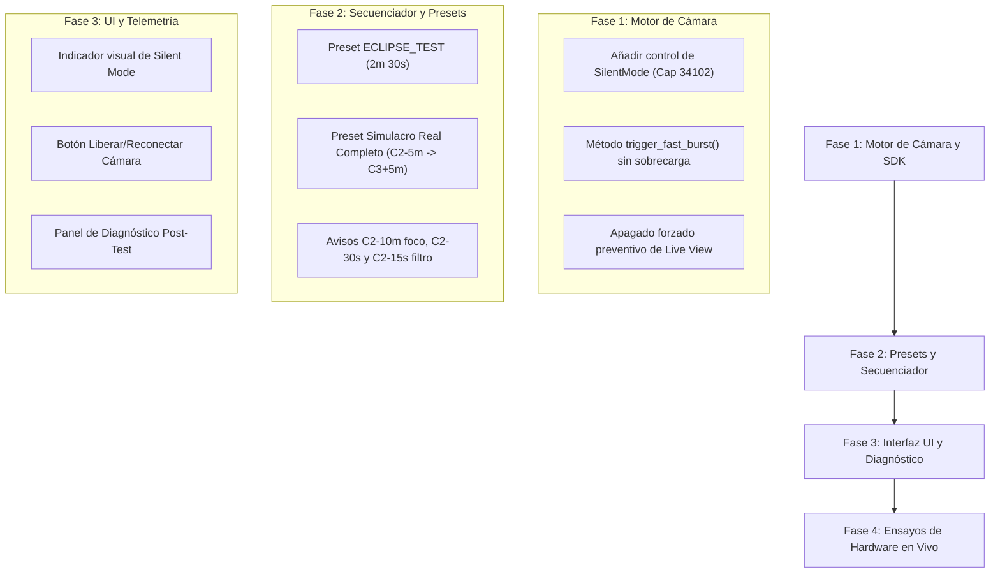

# Especificación Técnica: Captura de Perlas de Baily, Secuencia de Totalidad y Banco de Pruebas (Nikon Serie Z + 500mm)

**Documento:** `docs/especificacion_baily_y_simulacro_nikon_z.md`  
**Estado:** Especificación Aprobada para Implementación  
**Hardware Principal:** Nikon Z5 II (Mirrorless) + Teleobjetivo 500mm (Montura / Tracker)  
**Hardware Secundario (Diferido):** Nikon D750 + Gran Angular (Paisaje sin tracker)  

---

## 1. Justificación y Objetivos

La captura de las **Perlas de Baily** (*Baily's Beads*) y los **Anillos de Diamante** en la entrada ($C_2$) y salida ($C_3$) de la totalidad de un eclipse solar exige la máxima resolución temporal del sistema. A 500mm de focal:
1. Las perlas son fragmentos directos de fotosfera solar filtrada por el relieve lunar. Tienen un brillo superficial extremo ($B_\odot$).
2. **No se debe hacer horquillado (bracketing) durante Baily:** Cambiar la velocidad de obturación en esta fase quema los fotogramas lentos por sobreexposición y degrada la cadencia por latencia de bus USB ($50-100\,\text{ms}$ por cambio). Se requiere **exposición fija ultrarrápida ($1/4000\,\text{s}$)** a la **máxima cadencia de disparo sostenible**.
3. El bracketing dinámico de alto rango dinámico (HDR) se ejecuta exclusivamente durante los $60\,\text{segundos}$ de la totalidad para registrar desde la cromosfera interna hasta la corona externa tenue.
4. Para asegurar que la cámara responda a todas las órdenes sin bloquear el búfer ni congelar la aplicación, se establecen dos entornos de ensayo: un **Simulacro Real Completo** y un **Test Rápido de Hardware (`ECLIPSE_TEST`)**.

---

## 2. Cronograma Crítico de Contactos, Avisos de Voz y Disparos

```
LÍNEA TEMPORAL CRÍTICA ALREDEDOR DE C2 (ENTRADA A TOTALIDAD):

[C2 - 10 min] ──> Alerta Enfoque Térmico (Live View 100% y bloqueo físico de anillo)
      │
[C2 - 30.0s]  ──> Voz: "Quedan 30 segundos, preparado para el filtro"
      │
[C2 - 15.0s]  ──> Voz: "¡Quitar filtro solar ahora!" (Margen de 3-4s para desanclar)
      │
[C2 - 5.0s]   ──> Parada forzada de Live View (Despejar bus USB)
      │
[C2 - 4.0s]   ──> INICIO RÁFAGA BAILY ENTRADA (18 RAWs a 1/4000s, ISO 100)
      │
[C2 - 0.2s]   ──> Anillo de Diamante Entrada (1 RAW a 1/2000s, ISO 100)
      │
[C2 + 0.0s]  ════ TOTALIDAD (INICIO FASE OSCURA)
      │
[C2 + 2.0s]   ──> RÁFAGA HDR 1 (9 pasos EV: 1/2000s -> 2s)
      │
[C2 + 21.0s]  ──> Ventana de Vaciado de Búfer SD (Pausa técnica / tomas lentas)
      │
[C2 + 32.0s]  ──> RÁFAGA HDR 2 (9 pasos EV: 2s -> 1/2000s invertido)
      │
[C3 - 2.0s]   ──> Anillo de Diamante Salida (1 RAW a 1/2000s, ISO 100)
      │
[C3 + 0.0s]  ════ FIN TOTALIDAD (SALIDA)
      │
[C3 + 0.5s]   ──> INICIO RÁFAGA BAILY SALIDA (18 RAWs a 1/4000s, ISO 100)
      │
[C3 + 5.0s]   ──> Voz: "¡Atención: Colocar filtro solar inmediatamente!"
      │
[C3 + 10.0s]  ──> Tomas parciales post-C3 (Filtro ya colocado)
```

---

## 3. Matriz de Configuración: Responsabilidades Cámara vs. Software

| Parámetro | Responsable | Ajuste Requerido | Motivo Técnico |
| :--- | :--- | :--- | :--- |
| **Dial Físico de Modo** | **Usuario** | **M (Manual puro)** | La app no puede mover diales mecánicos. Si está en A/S/P, la Nikon rechaza órdenes. |
| **Modo de Enfoque** | **Usuario** | **MF (Manual Focus puro)** | Si la cámara intenta enfocar automáticamente, deniega el disparo por falta de contraste. |
| **Prioridad al Disparo** | **Usuario** | **Release (Disparo)** | Menú Z Custom Settings: el obturador dispara inmediatamente sin comprobación de foco. |
| **Horquillado Cámara (BKT)**| **Usuario** | **OFF (Desactivado en cuerpo)** | La app varía el obturador vía software. Si el BKT del cuerpo está activo, descompensa el guion. |
| **Modo de Avance** | **Usuario** | **S (Single Frame)** | La app comanda los pulsos con precisión milimétrica mediante bucles de disparo rápido. |
| **Balance de Blancos (WB)** | **Usuario** | **Sol Directo (Daylight ~5500K)** | **NUNCA Auto WB (AWB)**. AWB genera tintes dispares entre fotogramas impidiendo el apilado. |
| **Long Exposure NR** | **Usuario** | **OFF (Desactivado)** | Evita que tomas de $\ge 1\,\text{s}$ dupliquen su tiempo capturando un *dark frame*. |
| **High ISO NR** | **Usuario** | **OFF / Low** | Reduce el tiempo de procesamiento interno del procesador EXPEED. |
| **Silent Mode / E-Shutter** | **App + Usuario** | **ON (Activado)** | La app enviará `kNkMAIDCapability_SilentMode (34102)`; el usuario verifica el icono en pantalla. Cero trepidación a 500mm. |
| **Destino Guardado** | **Aplicación** | **Card Only (`SaveMedia=0`)** | Forzado por software para que NINGÚN archivo RAW viaje por USB durante la totalidad. |
| **Velocidad de Obturación**| **Aplicación** | **Dinámica ($1/4000\,\text{s} \dots 2\,\text{s}$)** | Controlada paso a paso por el secuenciador según el timeline. |
| **Sensibilidad ISO** | **Aplicación** | **Base 100** (Modificable EV) | Gobernado por software con soporte para compensación de nubes al vuelo. |
| **Live View On/Off** | **Aplicación** | **Off previo a ráfagas** | Apagado automático a $C_2 - 5\,\text{s}$ para liberar el ancho de banda del bus USB. |

---

## 4. Banco de Pruebas: Especificación de Simulacros

### 4.1 Simulacro Real Completo ($C_2 - 5\,\text{min}$ hasta $C_3 + 5\,\text{min}$)
* **Duración:** $\approx 12 - 14\,\text{minutos}$ (según duración de totalidad real del eclipse cargado).
* **Finalidad:** Ensayo general de concentración, gestión de filtros físicos y comprobación de fatiga de batería en condiciones operativas reales.
* **Secuencia:**
  * Parcial previa espaciada (1 foto cada 30 segundos con filtro solar).
  * Alertas verbales completas a los 30 s y 15 s previos a $C_2$.
  * Ejecución de Baily, Diamante y la totalidad completa con la duración exacta del emplazamiento GPS.
  * Alerta de filtro a $C_3 + 5\,\text{s}$ y parcial posterior.

---

### 4.2 Test Rápido de Hardware (`ECLIPSE_TEST`) — 2 min 30 s de Estrés
* **Duración:** $150\,\text{segundos}$ exactos ($C_2 - 60\,\text{s}$ hasta $C_3 + 30\,\text{s}$, con $60\,\text{s}$ de totalidad simulada).
* **Finalidad:** Comprobar la resiliencia del enlace USB, la capacidad del búfer físico de la Nikon Z5 II y el correcto guardado de los RAWs en tarjeta SD sin intervención manual.

#### Guion Detallado de `ECLIPSE_TEST`:
1. **$T = 0\,\text{s}$ ($C_2 - 60.0\,\text{s}$):**
   * Inicio del test. Verificación de enlace con Nikon Z SDK.
   * Ajuste de `SaveMedia = 0` (Card Only).
   * Verificación / activación de `SilentMode = 1`.
2. **$T = 50\,\text{s}$ ($C_2 - 10.0\,\text{s}$):**
   * Aviso por voz: *"Quedan 30 segundos, preparado para el filtro"* (emitido preventivamente si el test se arranca en frío).
3. **$T = 45\,\text{s}$ ($C_2 - 15.0\,\text{s}$):**
   * Aviso por voz: *"¡Quitar filtro solar ahora!"*. Pre-ajuste de velocidad a $1/4000\,\text{s}$, ISO 100.
4. **$T = 55\,\text{s}$ ($C_2 - 5.0\,\text{s}$):**
   * Parada obligatoria de Live View.
5. **$T = 56.0\,\text{s} \dots 59.5\,\text{s}$ ($C_2 - 4.0\,\text{s} \dots -0.5\,\text{s}$):**
   * **Ráfaga Rápida Baily Entrada:** 18 disparos continuos a $1/4000\,\text{s}$, ISO 100 directos a tarjeta SD (intervalo objetivo: $150 - 180\,\text{ms}$).
6. **$T = 59.8\,\text{s}$ ($C_2 - 0.2\,\text{s}$):**
   * Disparo único Anillo de Diamante Entrada ($1/2000\,\text{s}$, ISO 100).
7. **$T = 62.0\,\text{s} \dots 80.0\,\text{s}$ ($C_2 + 2.0\,\text{s} \dots +20.0\,\text{s}$):**
   * **Ciclo HDR 1 (9 tomas):** $1/2000, 1/1000, 1/500, 1/250, 1/60, 1/15, 1/4, 1\,\text{s}, 2\,\text{s}$.
8. **$T = 81.0\,\text{s} \dots 91.0\,\text{s}$ ($C_2 + 21.0\,\text{s} \dots +31.0\,\text{s}$):**
   * **Ventana de Desahogo:** Pausa técnica de $10\,\text{segundos}$ para que la tarjeta SD vacíe el búfer interno de la cámara.
9. **$T = 92.0\,\text{s} \dots 110.0\,\text{s}$ ($C_2 + 32.0\,\text{s} \dots +50.0\,\text{s}$):**
   * **Ciclo HDR 2 (9 tomas invertidas):** $2\,\text{s}, 1\,\text{s}, 1/4, 1/15, 1/60, 1/250, 1/500, 1/1000, 1/2000$.
10. **$T = 118.0\,\text{s}$ ($C_3 - 2.0\,\text{s}$):**
    * Disparo único Anillo de Diamante Salida ($1/2000\,\text{s}$, ISO 100).
11. **$T = 120.5\,\text{s} \dots 124.0\,\text{s}$ ($C_3 + 0.5\,\text{s} \dots +4.0\,\text{s}$):**
    * **Ráfaga Rápida Baily Salida:** 18 disparos continuos a $1/4000\,\text{s}$, ISO 100.
12. **$T = 125.0\,\text{s}$ ($C_3 + 5.0\,\text{s}$):**
    * Aviso por voz: *"¡Atención: Colocar filtro solar inmediatamente!"*.
13. **$T = 130.0\,\text{s} \dots 150.0\,\text{s}$ ($C_3 + 10.0\,\text{s} \dots +30.0\,\text{s}$):**
    * 2 disparos finales a $1/4000\,\text{s}$ y generación del informe de telemetría.

---

## 5. Procedimiento de Inspección Posterior de Fotografías

Finalizado el disparo, se contemplan dos vías de verificación:

### A. Inspección Física en Pantalla Abatible / Visor EVF de la Nikon Z (Prioritaria)
1. El usuario pulsa el botón en pantalla: **`[Liberar Cámara (Modo Play)]`**.
2. La aplicación cierra limpiamente la sesión USB/SDK.
3. La Nikon Z recupera el control de su botonera física.
4. El usuario pulsa el botón físico **▶ (Play)** y amplía al **100%** con el botón **(+)** sobre el borde del sol / manchas para evaluar nitidez, trepidación y rango dinámico.
5. Al pulsar **`[Reconectar Cámara]`**, la sesión USB se restablece en menos de $1\,\text{segundo}$.

### B. Inspección Remota en el Visor de `eclipZe`
1. La aplicación lee la última miniatura JPEG incrustada en la tarjeta mediante consulta de thumbnail PTP/SDK.
2. Renderiza la imagen en el widget `Visor SD / Encuadre` con recorte magnificado al centro y cálculo del histograma de brillo.

---

## 6. Plan de Implementación (Roadmap Técnico)



### Detalle de Tareas:
* **Módulo `core/camera.py`:**
  * Implementar comando `set_silent_mode(enable: bool) -> bool` en `NikonSdkDriver` y `NikonPTPDriver`.
  * Optimizar `trigger_burst()` para que ejecute ráfagas sin latencias intermedias ni lecturas de estado.
* **Módulo `core/presets.py`:**
  * Crear `get_eclipse_test_preset()` con los tiempos exactos definidos en la sección 4.2.
  * Actualizar `get_solar_eclipse_2027_preset()` para incorporar la alerta de foco a $C_2 - 10\,\text{min}$, aviso a $C_2 - 30\,\text{s}$ y retirada a $C_2 - 15\,\text{s}$.
* **Módulo `ui/main_window.py`:**
  * Integrar selector directo para `ECLIPSE_TEST (Estrés 2.5 min)`.
  * Mostrar resumen de disparos ejecutados vs. esperados al terminar la secuencia.
  * Añadir recordatorio visual persistente con botón de test de foco.
