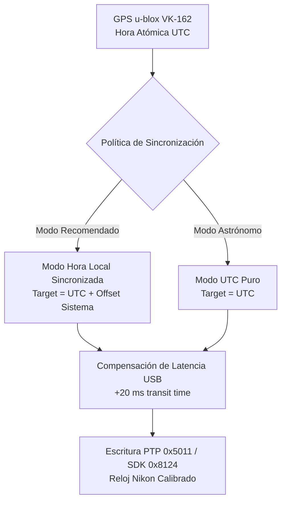

# Informe Técnico y Propuesta de Diseño: Sincronización Horaria Nikon Z / DSLR con GPS en eclipZe

**Proyecto:** eclipZe v2.0  
**Fecha:** Noviembre 2026  
**Documento:** `docs/propuesta_sincronizacion_reloj_nikon_gps.md`  
**Objetivo:** Especificar el diseño, arquitectura técnica, tratamiento de husos horarios y experiencia de usuario (UX) para leer el reloj de las cámaras Nikon (Z y DSLR) y sincronizarlas de forma precisa con el receptor GPS u-blox desde la pestaña de Gestión de Equipamiento.

---

## 1. Justificación y Objetivos Técnicos

En la astrofotografía de eclipses solares totales (en particular el próximo eclipse del 12 de agosto de 2026 en España), la precisión temporal es crítica:
* Fenómenos como los contactos $C_2$ y $C_3$, las **perlas de Baily**, el **anillo de diamantes** y la cromosfera solar transcurren en ventanas de apenas **1 a 3 segundos**.
* La correlación a posteriori de las imágenes capturadas con las efemérides astronómicas (`core/astronomy.py`) exige que los metadatos EXIF de cada disparo tengan una correspondencia exacta con el tiempo universal satelital.
* Los osciladores de cristal de cuarzo (RTC) internos de las cámaras fotográficas sufren desviaciones típicas de **entre 0.5 y 3 segundos al día**, acumulando desfases notables si no se ajustan en la misma jornada del eclipse.

**Objetivo de la propuesta:** Dotar a eclipZe de una función no invasiva para leer el reloj interno de los cuerpos conectados por USB, monitorizar su desfase respecto al GPS satelital y calibrar la hora de las cámaras con compensación de latencia de bus.

---

## 2. Viabilidad Técnica en Drivers Nikon por USB

El ecosistema de drivers de eclipZe (`core/camera.py`) cuenta con la infraestructura necesaria para soportar lectura y escritura horaria sin dependencias externas adicionales.

### 2.1. Driver Nativo PTP (`NikonPTPDriver`)
Las cámaras Nikon Z (Z5 II, Z6/Z7/Z8) implementan el estándar PTP (ISO 15740) sobre endpoints Bulk USB.
* **Device Property Code:** `0x5011` (`DateTime`).
* **Tipo de dato:** PTP String (`0xFFFF`), cadena terminada en nulo con formato ISO 8601 compacto:
  $$\text{Formato: } \texttt{"YYYYMMDDTHHMMSS"} \quad \text{o con subsegundos} \quad \texttt{"YYYYMMDDTHHMMSS.s"}$$
* **Operaciones PTP:**
  * **Lectura:** Opcode `0x1014` (`GetDevicePropValue(0x5011)`). Retorna el valor actual del reloj.
  * **Escritura:** Opcode `0x1016` (`SetDevicePropValue(0x5011)`). Aplica instantáneamente la nueva hora al RTC del cuerpo.
* **Latencia estimada:** **10 ms a 25 ms** en el bus USB Bulk.

### 2.2. Driver Oficial Nikon SDK (`NikonSdkDriver` / `NikonD750SdkDriver`)
A través del SDK remoto oficial de Nikon (módulo `Type0029` en Serie Z y `Type0015` en D750):
* **Identificador de Capacidad:** `kNkMAIDCapability_ClockDateTime` (`0x8124`, definida en `Win_DRV/HeaderFile/Maid3d1.h` como `kNkMAIDCapability_VendorBaseDX2 + 0x24`).
* **Estructura C subyacente (`Maid3.h`):**
  ```c
  typedef struct tagNkMAIDDateTime {
      UWORD nYear;        // Ej. 2026
      UWORD nMonth;       // 0 - 11 (ATENCIÓN: Base 0, Enero = 0)
      UWORD nDay;         // 1 - 31
      UWORD nHour;        // 0 - 23
      UWORD nMinute;      // 0 - 59
      UWORD nSecond;      // 0 - 59
      ULONG nSubsecond;   // Milisegundos / fracciones de reloj
  } NkMAIDDateTime;
  ```
* **Operaciones soportadas:** `kNkMAIDCapOperation_Get` y `kNkMAIDCapOperation_Set`.
* **Detalle de implementación:** `TestApp.exe` puede incorporar el comando de lectura/escritura de esta capacidad y exponerla mediante su protocolo de comandos por tubería (`stdin`/`stdout`).

### 2.3. Controladores Complementarios
* **`GPhotoCameraDriver`:** Lee y escribe la propiedad `/main/settings/datetime` mediante la API nativa de libgphoto2.
* **`MockCameraDriver`:** Simula el reloj interno de la cámara almacenando una marca base con deriva temporal programable, permitiendo verificar los tests automáticos sin hardware conectado.

### 2.4. Política de Sondeo de Bus (USB Overhead Prevention)
> [!IMPORTANT]
> **No interrogar el reloj a la cámara en bucle continuo de 1 Hz.**  
> Transmitir consultas PTP continuas mientras se prepara la ráfaga de totalidad puede introducir contención en el endpoint USB y aumentar el jitter de obturación. La lectura se ejecuta:
> 1. Al detectar/conectar la cámara.
> 2. Al pulsar el botón de comprobación/sincronización.
> 3. La interfaz calcula el delta $\Delta = T_{\text{cámara}} - T_{\text{GPS}}$ una sola vez y actualiza el reloj visual mediante extrapolación local en el hilo de la UI.

---

## 3. Arquitectura de Huso Horario: Estandarización UTC vs. Hora Local

### 3.1. Cómo gestiona Nikon el tiempo interno
1. Los cuerpos Nikon no mantienen un timestamp epoch Unix puro en su RTC; mantienen **horas, minutos y segundos de pared** que coinciden con lo que ve el fotógrafo en la pantalla trasera.
2. En el menú de la cámara existe la configuración de **"Zona horaria y fecha"** (ej. Madrid `UTC+1`, conmutador de horario de verano DST `ON` $\rightarrow$ `UTC+2`).
3. Al capturar una fotografía:
   * Graba en EXIF `DateTimeOriginal` la hora de pared configurada.
   * En firmware moderno, graba la etiqueta EXIF `OffsetTimeOriginal` (ej. `+02:00`).
4. Si por PTP o SDK se envía directamente la hora satelital UTC (`17:30:00 UTC` cuando localmente son las `19:30:00 CEST`):
   * La cámara cambiará su hora visual a `17:30:00`.
   * En la pantalla y en las fotos, las tomas parecerán disparadas 2 horas antes, generando confusión grave al fotógrafo en campo.

### 3.2. Estrategia de Dos Modos de Sincronización

Para eliminar el riesgo de error humano, el sistema soportará dos políticas transparentes:



1. **Modo 1: Hora Local Sincronizada con GPS (Recomendado por defecto)**
   * Fórmula: $T_{\text{target}} = T_{\text{GPS\_UTC}} + \text{Offset}_{\text{Sistema/Local}}$
   * La cámara muestra en todo momento la hora civil local de la ubicación del eclipse (CEST en 2026), pero con la exactitud de décimas de segundo del reloj atómico GPS.
2. **Modo 2: Hora UTC Pura (Avanzado astronómico)**
   * Fórmula: $T_{\text{target}} = T_{\text{GPS\_UTC}}$
   * Dirigido a observatorios y fotógrafos científicos que configuran explícitamente el menú del cuerpo de la cámara en zona horaria cero (`UTC+0`).

### 3.3. Detección Heurística de Anomalías Horarias
Al leer la hora de la cámara por primera vez, el sistema compara $T_{\text{cámara}}$ con el tiempo de referencia:
* Si $|T_{\text{cámara}} - T_{\text{Local}}| < 60\text{ s}$ $\rightarrow$ La cámara está en **Hora Local**.
* Si $|T_{\text{cámara}} - T_{\text{UTC}}| < 60\text{ s}$ $\rightarrow$ La cámara está en **Hora UTC**.
* Si el desfase es cercano a $\pm 3600\text{ s}$ o $\pm 7200\text{ s}$ ($\pm 1\text{h}$ ó $\pm 2\text{h}$):
  * La UI emite una **alerta preventiva destacada**:  
    *⚠️ "La cámara tiene un desfase de exactamente +2h respecto a UTC. Verifique si el menú del cuerpo tiene activo el Horario de Verano (DST) antes de forzar UTC puro."*

---

## 4. Diseño UX / UI en "Gestión de Equipamiento"

La pestaña de **Gestión de Equipamiento** (`ui/main_window.py`) es el lugar natural para esta funcionalidad, ya que gestiona de manera independiente las ranuras **Ranura A (Master)** y **Ranura B (Secundaria)**.

### 4.1. Visualización en la Tarjeta de cada Ranura
En cada tarjeta de cámara (`group_slot_a` y `group_slot_b`), debajo de la fila de telemetría de batería y tarjeta SD, se incorpora un panel de reloj compacto:

```
┌────────────────────────────────────────────────────────────────────────┐
│ 🕒 Reloj Cámara: 19:30:14.2  [ Δ GPS: -0.8 s ]  [🟡 Desviación leve]   │
│ [⏱️ Sincronizar Reloj con GPS]  [⚙️ Opciones de Zona]                   │
└────────────────────────────────────────────────────────────────────────┘
```

#### Elementos:
1. **Etiqueta dinámica de reloj y desfase:**
   * Muestra la hora extrapolada del cuerpo y el valor numérico del desfase $\Delta$.
2. **Semáforo cromático de precisión:**
   * 🟢 **Verde** ($|\Delta| < 0.2\text{ s}$): Calibrada con precisión de alta velocidad.
   * 🟡 **Amarillo** ($0.2\text{ s} \le |\Delta| \le 2.0\text{ s}$): Desviación natural de cuarzo; recomendable sincronizar.
   * 🔴 **Rojo** ($|\Delta| > 2.0\text{ s}$ o salto de huso horario): Reloj desfasado o error de zona horaria.
3. **Botón individual `[⏱️ Sincronizar Reloj con GPS]`:**
   * Ejecuta la calibración específica de esa ranura. Si el GPS tiene fix válido, aplica la corrección inmediatamente y notifica en el registro:  
     `[19:30:15] Ranura A: Reloj sincronizado con GPS UTC (+02:00 Local). Desfase residual < 0.03s.`

### 4.2. Control Maestro en la Barra Global Superior
En la barra `bar_group` ("Control Global de Equipamiento y Prioridad Temporal"), junto al botón de escaneo USB y reconexión:

1. **Botón Global: `[⏱️ Sincronizar Relojes (A y B) con GPS]`**:
   * Calibra ambas cámaras en paralelo con un desfase temporal compensado, garantizando que el disparo simultáneo de ambas ranuras durante las perlas de Baily mantenga una concordancia EXIF perfecta.
2. **Selector Rápido de Zona Horaria:**
   * Desplegable directo: `Referencia: [ Hora Local (UTC+2) ▼ ]` con opciones:
     * `Hora Local del PC / Ubicación (Recomendado)`
     * `Hora UTC Satelital Pura`

---

## 5. Especificación de Métodos de Código a Implementar

A continuación se detalla la signatura y comportamiento de los métodos requeridos en cada capa de la arquitectura (sin alterar el código fuente todavía):

### 5.1. Capa de Driver (`core/camera.py`)
```python
class CameraDriver(ABC):
    @abstractmethod
    def get_clock_time(self) -> Optional[datetime.datetime]:
        """Lee la hora actual del RTC interno de la cámara."""
        pass

    @abstractmethod
    def set_clock_time(self, target_dt: datetime.datetime) -> bool:
        """Ajusta el RTC interno de la cámara a la fecha/hora especificada."""
        pass
```
* **En `NikonPTPDriver`:**
  * Implementa `get_clock_time()` mediante PTP Opcode `0x1014` (`GetDevicePropValue`) con la propiedad `0x5011`.
  * Implementa `set_clock_time()` mediante PTP Opcode `0x1016` (`SetDevicePropValue`) con payload string formateado.
* **En `NikonSdkDriver`:**
  * Solicita o envía el struct `NkMAIDDateTime` a través de capability `0x8124`.

### 5.2. Capa de Equipamiento (`core/equipment.py`)
```python
class EquipmentManager:
    def sync_camera_clock(self, slot_id: str, gps_data: GPSData, use_utc: bool = False) -> Tuple[bool, str, float]:
        """
        Calcula la hora objetivo compensando latencia USB y sincroniza la ranura indicada.
        Retorna (éxito, mensaje, desfase_previo).
        """
```

### 5.3. Capa de Interfaz Gráfica (`ui/main_window.py`)
* Conexión del evento `clicked` de los botones de sincronización con workers no bloqueantes.
* Actualización periódica del semáforo visual dentro del temporizador principal de 100 ms (`_update_clock_bar`).

---

## 6. Riesgos y Consideraciones de Operación en Campo

1. **SnapBridge / Sincronización Bluetooth del Móvil:**
   * Si el fotógrafo tiene la cámara enlazada por Bluetooth con la aplicación Nikon SnapBridge en su smartphone, SnapBridge sobreescribe periódicamente el reloj de la cámara según el reloj del teléfono (que suele tener latencias de red celular de 500 ms a 1 s).
   * **Recomendación en UI:** Mostrar una advertencia en el checklist previo recomendando poner la cámara en **Modo Avión** durante la expedición del eclipse.
2. **Restricción de Live View:**
   * Algunos firmwares de Nikon Z bloquean la escritura de propiedades de reloj (`0x5011`) mientras el sensor está transmitiendo streaming de Live View activo. La función de sincronización debe pausar momentáneamente el Live View antes de enviar el comando PTP y reactivarlo inmediatamente después.
3. **Pérdida de Señal Satelital (Falta de GPS Fix):**
   * Si el usuario pulsa sincronizar y el GPS aún no tiene cobertura de satélites en el dongle VK-162, el sistema debe ofrecer automáticamente calibrar contra el reloj local del ordenador como mecanismo de contingencia (*fallback*).

---

*Fin del informe técnico.*
